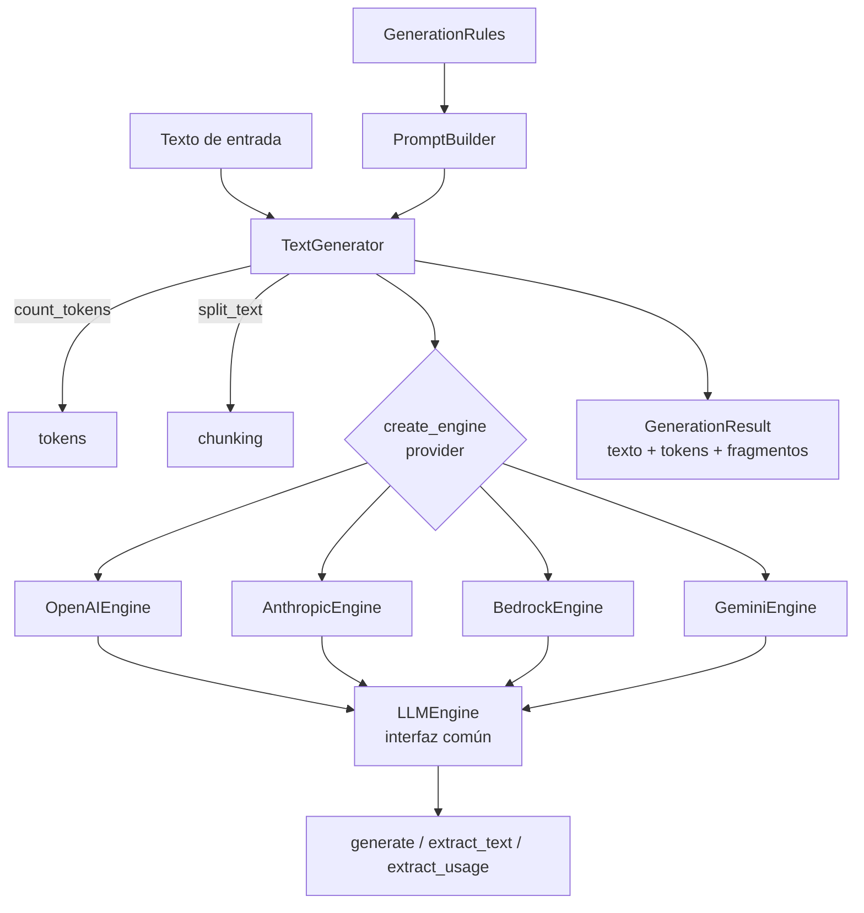

# Arquitectura

`llm-engines` combina un patrón **Adapter + Factory** (conectores) con un
**pipeline de generación** que conecta las reglas con la llamada al modelo.

## Diagrama

## Capas

1. **Pipeline de generación (`generation/`)**
   - `GenerationRules` (`rules.py`): definición declarativa de qué se pide y cómo.
   - `PromptBuilder` (`prompt_builder.py`): construye los mensajes finales y los
     de cada *chunk* con delimitadores.
   - `tokens.py` / `chunking.py`: conteo de tokens y *chunking* (con fallbacks).
   - `TextGenerator` (`pipeline.py`): orquesta presupuesto de contexto →
     *chunking* → resumen de fragmentos → llamada final, y devuelve un
     `GenerationResult`. Solo usa la API pública de los engines.

2. **Factoría (`factory.py`)**
   `create_engine(provider, **kwargs)` resuelve el proveedor contra un registro
   y construye el engine adecuado.

3. **Interfaz común (`base.py`)**
   `LLMEngine` define el contrato: `generate`, `extract_text`, `extract_usage`,
   `get_context_limit`.

4. **Adaptadores (`openai.py`, `anthropic.py`, `bedrock.py`, `gemini.py`)**
   Cada engine implementa la interfaz traduciendo:
   - El formato de mensajes al del SDK nativo.
   - Los hiperparámetros normalizados (`temperature`, `topP`, `maxTokens`) a los
     nombres de cada API (`param_map`).
   - El filtrado de parámetros no soportados por ciertos modelos
     (`unsupported_by_model`).
   - La extracción de texto y uso de tokens desde la respuesta nativa.
   - Sus propios reintentos con *backoff* exponencial
     (`MAX_RETRIES` / `BACKOFF_FACTOR` de `constants.py`).

## Decisiones de diseño

- **Engines publicados tal cual**: `base`, `openai`, `anthropic`, `bedrock` y
  `gemini` son idénticos a los de producción (solo cambia de dónde importan
  `constants`). Así el código compartido es exactamente el probado.
- **Hiperparámetros normalizados** (`temperature`, `topP`, `maxTokens`): claves
  únicas en el borde público; cada engine las mapea internamente.
- **Reintentos con backoff exponencial** en cada engine, con los valores por
  defecto en `constants.py`.
- **Límites de contexto**: se consultan vía API cuando el proveedor lo permite
  (Gemini) y se complementan con diccionarios de fallback por engine.
- **Dependencias opcionales**: cada proveedor se instala como *extra*, de modo
  que no es obligatorio instalar todos los SDKs (carga perezosa en la factoría).
- **Sin estado global de secretos**: las credenciales se inyectan al construir
  cada engine; la librería no lee secretos por su cuenta.

## Cómo añadir un nuevo proveedor

1. Crea `src/llm_engines/<nuevo>.py` heredando de `LLMEngine`.
2. Implementa `generate`, `extract_text`, `extract_usage`, `get_context_limit`
   y define `param_map` / `unsupported_by_model`.
3. Regístralo en `factory.py` (`_REGISTRY`) y, si quieres exportarlo, en
   `__init__.py` (`_LAZY_ENGINES`).
4. Añade el *extra* correspondiente en `pyproject.toml` y un test en `tests/`.
